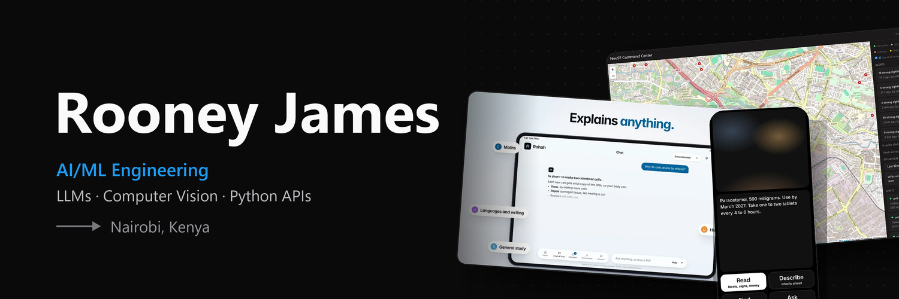

 

 

 

* 🎓 Software engineering student at **Multimedia University of Kenya**, graduating in 2029.

* 🏆 **2nd place at an MLH hackathon** as lead coder on [GemmaSight](https://github.com/808kirai/GemmaSight), and 4th at a Google Developer Groups hackathon.

* 🚀 Building [Rahah](https://rahah.onrender.com), an AI study platform with real users, and [NeuSE](https://github.com/808kirai/NeuSE) for the **Huawei ICT Competition 2026–27**.

* 🧠 I work with **LLMs** (Claude, Gemma, Nemotron), **computer vision** and **Python APIs**, and I'm a member of the **NVIDIA Developer Program**.

* 💬 Kiswahili, English and some Mandarin. More at [kirai-portfolio.vercel.app](https://kirai-portfolio.vercel.app).

### 🛠️ Projects

<table>
<tr><th colspan="3">Products and live work</th></tr>
<tr><th width="44%">Project</th><th width="10%">Stars</th><th width="46%">Tech / Links</th></tr>
<tr><td><a href="https://github.com/808kirai/Rahah"><b>Rahah</b></a> AI study platform for Kenyan students. Answers cite the page of your notes. 191 tests.</td><td></td><td>      </td></tr>
<tr><td><a href="https://github.com/808kirai/AmaniHaven"><b>AmaniHaven</b></a> Free mental health support over SMS and USSD, in English or Kiswahili. 74 tests.</td><td></td><td>     </td></tr>
<tr><td><a href="https://github.com/808kirai/myPortfolio"><b>Portfolio</b></a> This site: projects, case studies and animated product demos.</td><td></td><td>   </td></tr>
</table>

<table>
<tr><th colspan="3">AI and computer vision</th></tr>
<tr><th width="44%">Project</th><th width="10%">Stars</th><th width="46%">Tech / Links</th></tr>
<tr><td><a href="https://github.com/808kirai/GemmaSight"><b>GemmaSight</b></a> Vision co-pilot for blind and low-vision people. 2nd place, MLH hackathon.</td><td></td><td>     </td></tr>
<tr><td><a href="https://github.com/808kirai/NeuSE"><b>NeuSE</b></a> Offline search and rescue on thermal drone footage. Huawei ICT Competition 2026–27.</td><td></td><td>     </td></tr>
<tr><td><a href="https://github.com/808kirai/Greenlight"><b>Greenlight</b></a> An AI agent that fixes broken dependency-upgrade PRs. Early stage.</td><td></td><td>   </td></tr>
<tr><td><a href="https://github.com/808kirai/face-tracking"><b>Face Tracking</b></a> Real-time hand and face tracking filters from a webcam.</td><td></td><td>   </td></tr>
<tr><td><a href="https://github.com/808kirai/Celestial-Image-Identifier"><b>Celestial Image Identifier</b></a> Detects and catalogs bright sky targets in images or a live webcam.</td><td></td><td>    </td></tr>
</table>

<table>
<tr><th colspan="3">Web and systems</th></tr>
<tr><th width="44%">Project</th><th width="10%">Stars</th><th width="46%">Tech / Links</th></tr>
<tr><td><a href="https://github.com/808kirai/Nairobi-Parking-System"><b>Nairobi SmartPark</b></a> Parking management with live slot counts and tiered fees in Kshs.</td><td></td><td>   </td></tr>
</table>

📈 Stats

 

